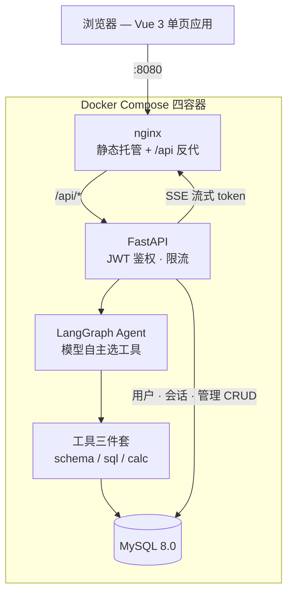
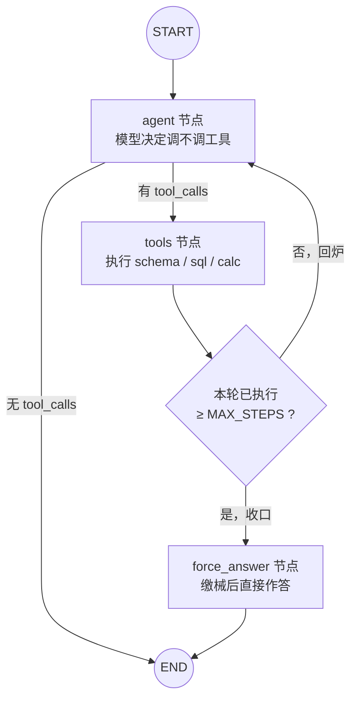
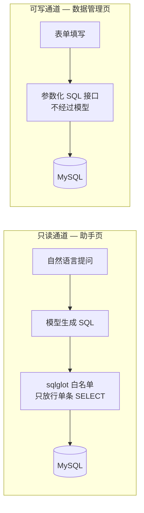

# 物流仓储数据分析助手（ChatBI）

用自然语言查询业务数据库：**你问一句话，系统自动生成 SQL、查询数据、并把结果用自然语言讲给你听。**

面向物流仓储履约运营场景，业务覆盖仓库、商品、库存、入库单、出库单、运单。

## 效果示例

> **问**：各仓库的库存总量分别是多少
>
> **答**：8 个仓库的库存总量大多在 10 万件上下：华东仓最多，为 109,620 件；华东二仓最少，96,167 件，整体分布比较均衡。
>
> **生成的 SQL**：
> ```sql
> SELECT w.warehouse_name, SUM(i.stock_qty) AS total_stock
> FROM inventory i
> JOIN warehouses w ON i.warehouse_id = w.warehouse_id
> GROUP BY w.warehouse_id, w.warehouse_name
> ```

支持**多轮追问**：

> **问**：那华东仓的库存占八仓总量的百分之多少？
>
> **答**：华东仓库存 109,620 件，占八仓总库存的 13.37%，约为总量的七分之一。

## 技术栈

Python · LangGraph · LangChain · DeepSeek API · MySQL · FastAPI · Vue 3 · MCP · Docker · uv

## 系统架构



### Agent 图的执行流程



### 两条互不打通的数据通道



## 核心设计

### 1. 工具三件套

| 工具 | 作用 |
|---|---|
| `schema_tool` | 查表结构，喂给模型让它知道表名与字段名 |
| `sql_tool` | 执行只读 SQL：只放行 SELECT、结果超限自动截断、异常转文本返回 |
| `calc_tool` | 代码算数：正则白名单 + 空 builtins 双重防护 |

### 2. Agent 自主决策

模型手里拿着这包工具，**自己决定**调哪个、调几次，而不是走写死的流水线：

```
START → agent ─┬─ 需要工具 → tools ─┐
               │                     │
               └─ 可以回答 → END ←───┘   （工具跑完回到 agent）
```

实际表现：

- 问「你好」→ 不调任何工具，直接回话
- 问「库里有哪些表」→ 调 `schema_tool`
- 问「各仓库库存总量」→ 调 `sql_tool`（必要时先调 schema 确认字段）

### 3. SQL 错误自纠

SQL 执行失败时，条件边把**报错信息**路由回修复节点，由模型带着报错重写、重试；重试上限由 state 计数控制，不依赖框架默认值。

### 4. 多轮对话

基于 LangGraph checkpoint + `thread_id` 持久化会话状态，支持依赖上文的追问。

### 5. MCP 对照版

同一套数据库工具，另做了一条 **MCP（Model Context Protocol）** 路径，与「直接注册成 LangGraph 工具」对照：

| | 直接注册（`agent_graph.py`） | MCP 版（`try_agent_mcp.py`） |
|---|---|---|
| 工具住哪 | 同一个进程 | 独立子进程 |
| 怎么调用 | 普通函数调用 | stdio 协议 |
| 同步/异步 | 同步 | 异步 |
| 复用范围 | 仅本项目 | 任何 MCP 客户端 |

- `src/chatbi/mcp_server.py` —— 用 `MCPServer` 把三个工具暴露成一个独立进程
- `src/chatbi/mcp_tools.py` —— 客户端侧：起子进程、拉工具清单、把 MCP 的 `input_schema` 翻译成 LangChain 的 `args_schema`（官方适配器 `langchain-mcp-adapters` 目前仍基于 mcp 1.x API，与本机 mcp 2.x 不兼容，故手写这一层）
- `scripts/try_agent_mcp.py` —— 异步版 Agent 图，工具在运行时从 MCP 拉取

价值：**进程隔离**（server 崩了不拖垮主程序）、**跨语言**、一份 server 可同时供多个客户端使用。

### 6. 安全防护

- **SQL 白名单**：不靠关键词黑名单（会误杀 `WHERE product_name='drop table'`、又会漏杀 `SELECT ... INTO OUTFILE`），改用 `sqlglot` 把 SQL 解析成语法树——**只放行根节点为 `SELECT` 的单条语句**；解析失败一律拒绝（fail-closed）
- **查询超时**：连接设 `read_timeout`，`SELECT SLEEP(300)` 这类慢查询 10 秒内被掐断，不会拖死服务
- **结果脱敏**：在工具层对敏感列（`manager` / `customer`）打码，结果流向模型 / 日志 / 前端之前先过滤
- **死循环防护**：Agent 图三层——步数上限（`MAX_STEPS`，数已执行的工具轮数）+ 软着陆（超限转「收口节点」，缴械后直接回答）+ `recursion_limit` 框架保险丝

### 7. 用户系统与会话隔离

- 注册即写入 `users` 表，密码用 **PBKDF2-HMAC-SHA256 + 随机盐**存储；验证走 `hmac.compare_digest` 常数时间比较，防时序攻击
- 登录签发 **JWT**（HS256，7 天过期），`get_current_user` 依赖从请求头解出 `user_id`
- **会话按用户隔离**：`conversations` 表记「谁的 / 标题 / 时间」，LangGraph 的状态快照交给框架的 MySQL checkpointer，两者用 `thread_id` 挂钩；越权访问返回 403
- **限流**：按 `user_id` 的滑动窗口（60 秒 10 次），超限 429

### 8. 流式输出

- 后端用同步 `graph.stream(stream_mode="messages")` 逐 token 产出，按 `metadata["langgraph_node"]` **只放行最终回答节点**（过滤掉工具节点的原始产物，否则表结构和查询结果会被当正文吐出来）
- SSE 协议分三类事件：`token`（正文）、`status`（"正在查询数据…"阶段提示）、`sqls`（本轮实际执行的 SQL，供前端折叠展示）
- 前端手写 SSE 解析（`fetch` + `ReadableStream`——`EventSource` 只支持 GET，而我们是 POST），配合 `markdown-it` 渲染表格与加粗
- ⚠️ **nginx 反代必须 `proxy_buffering off`**，否则 token 会被攒着不吐、流式退化成一次性返回

### 9. 评估与压测

**20 题业务评估集**（`eval/questions.py`），每题配标准 SQL，跑模型实际作答后按三个口径判分：

| 口径 | 含义 | 结果 |
|---|---|---|
| 严格 | 结果集与标准答案完全一致（忽略行序） | 9/20 |
| 宽松 | 允许模型多返回列（做列投影比较） | 15/20 |
| **结论正确** | 标准答案的关键数值出现在最终回答里（带容差、识别「万 / 亿」） | **19/20** |

> 判分口径值得说明：这是**多轮 Agent**，"它执行的 SQL" ≠ "它给出的答案"。模型常先跑一条正确查询再补一条探量查询，或返回全量明细后自己从里面挑出答案。只比对「最后一条 SQL 的结果集」会严重低估——初版口径跑出来只有 35%。

唯一算错的一题是题目本身有歧义（「签收超过 5 天」既可理解为运输时长、也可理解为距今）。

**压测**（`scripts/bench.py`，16 题 × 并发 1/2/4/8）：

| 并发 | 平均延迟 | P95 | QPS | 失败 |
|---|---|---|---|---|
| 1 | 4.72s | 6.30s | 0.21 | 0 |
| 2 | 4.97s | 6.76s | 0.39 | 0 |
| 4 | 4.75s | 7.18s | 0.82 | 0 |
| 8 | 4.85s | 6.53s | **1.23** | 0 |

结论：**延迟不随并发恶化**——瓶颈在模型 API，不在服务 / 框架 / 数据库；QPS 随并发近线性增长，并发 8 仍未饱和。单次问答约消耗 5.5–6.1k token。

### 10. 工程化

- **pytest 单测**：6 文件 33 用例，覆盖 SQL 白名单、密码哈希与 JWT、Agent 轮次（给修过的 bug 加回归）、限流、判分逻辑——全部不依赖大模型与网络
- **Docker 一键运行**：四容器编排（`db` / `seed` / `api` / `web`），首次启动自动建表灌数；前端多阶段构建，产物镜像不含源码
- **密钥隔离**：所有密钥只存 `.env`（不进 git、不进镜像），容器里靠环境变量注入

## 项目结构

```
chatbi/
├── Dockerfile                 # 后端镜像（python:3.14-slim + pip 装依赖）
├── docker-compose.yml         # 四容器编排：db / seed / api / web
├── requirements.txt           # 由 uv.lock 导出的依赖清单（构建镜像用）
├── sql/                       # 01_schema（6 张业务表）/ 02_users / 03_conversations
├── eval/
│   ├── questions.py           # 20 题评估集（题目 + 标准 SQL）
│   └── run_eval.py            # 判分脚本（严格 / 宽松 / 结论正确 三口径）
├── tests/                     # pytest 单测（6 文件 33 用例）
├── scripts/
│   ├── gen_data.py            # 造数脚本（近 7 万条模拟数据）
│   ├── seed.py                # 容器灌数入口（空库才灌，已有数据跳过）
│   ├── bench.py               # 压测脚本（并发梯度扫描）
│   └── try_*.py               # 各阶段试跑脚本
├── web/                       # Vue 3 + Vite 前端
│   ├── Dockerfile             # 多阶段构建：Node 编译 → nginx 托管
│   ├── nginx.conf             # 静态托管 + /api 反代（SSE 关闭缓冲）
│   └── src/                   # 登录 / 首页 / 助手 / 数据管理 / 仓库统计
└── src/chatbi/
    ├── config.py              # 配置集中管理（.env）
    ├── db.py                  # MySQL 连接与查询
    ├── api.py                 # ★ FastAPI 应用入口（路由 + SSE 流式）
    ├── auth.py                # 密码哈希（PBKDF2）+ JWT
    ├── deps.py                # 依赖注入：当前用户 + 限流
    ├── admin.py               # 数据管理 CRUD 接口
    ├── stats.py               # 仓库统计接口
    ├── agent_graph.py         # ★ Agent 图（模型自主选工具）
    ├── mcp_server.py          # MCP server：把工具暴露成独立进程
    ├── mcp_tools.py           # MCP client：拉工具并转成 LangChain 工具
    ├── nodes/                 # SQL 生成 / 修复 / 结果解读
    └── tools/                 # 工具三件套及其 LangChain 封装
```

## 快速开始

### 方式一：Docker 一键运行（推荐）

**前置**：[Docker Desktop](https://www.docker.com/products/docker-desktop/)、一个 DeepSeek API Key。

```bash
cp .env.example .env         # 填入 DEEPSEEK_API_KEY 和 DB_PASSWORD
docker compose up -d --build
```

打开 **http://localhost:8080** 即可使用。

首次启动自动完成：建库建表 → 灌入约 7 万条模拟数据 → 启动后端 → 启动前端。

| 容器 | 作用 | 端口 |
|---|---|---|
| `db` | MySQL 8.0，首次启动自动执行 `sql/*.sql` 建表 | 3307 |
| `seed` | 灌数据，**跑完即退出**；库里已有数据时自动跳过 | — |
| `api` | FastAPI 后端（等 `seed` 灌完才启动） | 8000 |
| `web` | nginx：托管前端静态文件 + 反代 `/api` 到后端 | **8080** |

```bash
docker compose down          # 停止（数据保留在数据卷里）
docker compose down -v       # 停止并删除数据卷（下次启动会重新灌数）
docker compose logs -f api   # 跟踪后端日志
```

接口文档（Swagger）：http://localhost:8000/docs

### 方式二：本机开发环境

**前置**：本地 MySQL、Python 3.14、[uv](https://docs.astral.sh/uv/)、Node 20+、一个 DeepSeek API Key。

**1. 建库建表**

```bash
mysql -uroot -p -e "CREATE DATABASE chatbi_logistics DEFAULT CHARACTER SET utf8mb4;"
mysql -uroot -p --default-character-set=utf8mb4 chatbi_logistics < sql/01_schema.sql
mysql -uroot -p --default-character-set=utf8mb4 chatbi_logistics < sql/02_users.sql
mysql -uroot -p --default-character-set=utf8mb4 chatbi_logistics < sql/03_conversations.sql
```

**2. 配置环境变量**

复制 `.env.example` 为 `.env`，填入自己的值：

```
DEEPSEEK_API_KEY=sk-你的key
DB_HOST=127.0.0.1
DB_PORT=3306
DB_USER=root
DB_PASSWORD=你的密码
DB_NAME=chatbi_logistics
JWT_SECRET=随机字符串
```

**3. 装依赖 + 灌数据**

```bash
uv sync
uv run python scripts/gen_data.py
```

**4. 启动 Web 应用**

```bash
uv run uvicorn chatbi.api:app --reload --port 8000   # 后端
cd web && npm install && npm run dev                 # 前端 → http://localhost:5173
```

**5. 命令行试跑（可选）**

```bash
uv run python scripts/try_agent.py       # Agent 版（工具在同一进程）
uv run python scripts/try_agent_mcp.py   # MCP 版（工具在独立进程）
```

## 开发进度

- [x] 数据层：6 张关联业务表 + 造数脚本
- [x] 工具三件套（查表结构 / 执行只读 SQL / 代码算数）
- [x] LangGraph 图编排 + SQL 错误自纠循环
- [x] Agent 自主选择工具 + 多轮对话
- [x] MCP 对照版
- [x] 安全防护：SQL 真解析白名单 / 查询超时 / 结果脱敏 / Agent 死循环防护
- [x] 用户系统：注册 / 登录（JWT）/ 改密码，会话按用户隔离
- [x] Web 前端：登录 / 首页 / 助手（流式 + 可折叠 SQL）/ 数据管理 / 仓库统计
- [x] FastAPI + SSE 接口（JWT 鉴权 + 按用户限流）
- [x] 20 题评估集（结论答对 19/20）与压测报告（并发 1→8，QPS 0.2→1.2）
- [x] pytest 单元测试（6 文件 33 用例）
- [x] Docker 打包（四容器一键启动）
